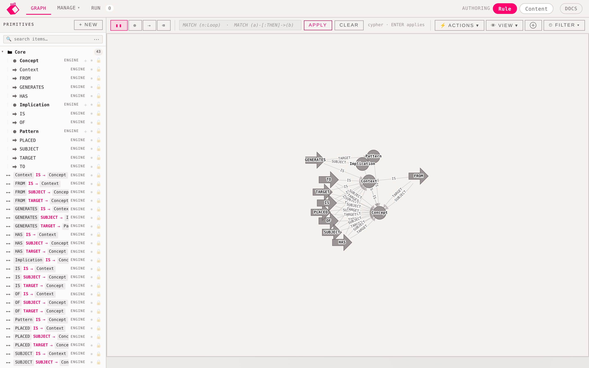
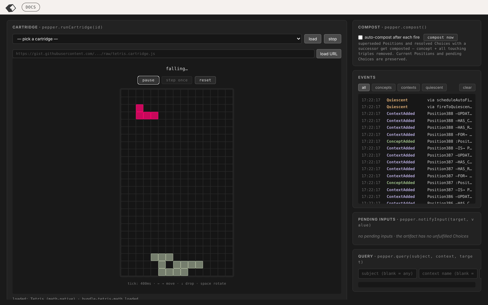

# salt

**A typed-triple rule engine that runs card games — in one HTML file, with no dependencies.**

> salt writes the rules · pepper brokers the inputs · the artifact holds the truth · shaker shakes it loose

Open `index.html` in a browser. That's the whole install. Or play with it live: **https://brandonjcampbell.github.io/Salt/**



## What it is

salt is an experiment in building game logic as an ontology instead of as code. The entire state of a game — the board, the pieces, the history, the pending decisions — is a graph of typed triples (`subject → predicate → target`). The rules are *implications*: match a pattern of triples, materialize new triples. The engine runs match → fire → mutate → re-match until nothing changes.

There are no flags, no markers, no hidden state. If a thing is true, there's a triple that says so, and you can query it. Debugging is `grep` the artifact.

Four roles, strictly separated:

| Role | Job | Can write to the graph? |
|---|---|---|
| **salt** | The rule layer. Pure implications over the artifact. | Yes — but only via rules that fire. |
| **pepper** | The input broker. When the artifact mints a `Choice`, pepper is the only thing allowed to resolve it (`choice CHOSE option`), and it validates the choice first. | Yes — but only `CHOSE` triples, only valid ones. |
| **cartridge** | A specialized pepper UI for one bundle (Tetris, a card game, an ontology readout). Owns the canvas, renders from the artifact, talks to it *only* through pepper. | No — reads only; inputs go through `pep.notifyInput`. |
| **shaker** | The assistant. A language model briefed with the docs and a live digest of the artifact. Explains why a rule fired (by running its OF body and reading the bindings), drafts rules, plays. | Only the two ways you can: authoring rule/content triples, patterns and implications (never runtime), and playing through `pepper.notifyInput`. Everything it authors is `X AUTHORED_BY Shaker` and undoable. |



*Pepper mode running Tetris. Every falling block is a chain of `Position` concepts linked by `UPDATES`; the event log on the right is the artifact narrating itself.*

## The model

- **Concept** — a named node. Predicates are concepts too, so the graph is reflective.
- **Context** — a directed triple. `p:Position AT_CELL c:Tile`.
- **Pattern** — a body of triples. An implication is an `OF` pattern (precondition) and a `GENERATES` pattern (consequence), with typed variables, `NOT`/`NEQ` filters, and `MINT` for fresh concepts.
- **Layers** — every triple lives in one of four: `bundle` (imported schema, read-only), `rule` (your authored schema), `content` (the dataset), `runtime` (disposable — what the engine minted and can throw away).

Type membership is just `IS` edges, walked transitively. There's no type registry; a rule that writes `o IS Chosen` really does change what queries see.

```
// "When a falling position has empty south, mint a new position one cell south."
Tetris_StepDownOf:                Tetris_StepDownGen:
  step:Choice IS Step               MINT next:Position
  step:Choice CHOSE Down            next FOR     b:Block
  p:Position FOR b:Block            next AT_CELL south:Tile
  p AT_CELL  c:Tile                 next UPDATES p:Position
  NOT newer:Position UPDATES p
  south:Tile SOUTH-OF c
```

State is additive: nothing mutates. A moved piece is a *new* `Position` with `UPDATES` pointing at the old one; "current" means "has no successor." History is free, and `compost` sweeps superseded runtime triples when you want it to.

## What's in the repo

```
index.html                   the editor + engine + pepper, self-contained (~640 KB)
ontology_editor.html         same file, alternate name
bundles/                     importable ontologies: cards, tiles, spatial, temporal,
                             agency, loop, playspace, input, attributes, session
tetrismath.cartridge.js      Tetris as a salt ontology + cartridge
salt-session.cartridge.js    derived-scope readout for the session ontology
```

Built-in docs (the `docs` button in the header) cover the matcher, the fire budget, compost semantics, and a list of patterns and antipatterns learned the hard way.

## Shaker

The `shaker` button opens a drawer in either mode. Shaker is briefed with the built-in docs — including the antipatterns — and a digest of the loaded artifact, and it reads more on demand with actions (`query`, `triples`, `bindings`, `pattern`, `concept`, `pending`, `log`). When you ask it to change something or to play, it ends its reply with a fenced `salt-actions` block, and what happens next depends on the level you set:

| Level | What Shaker does |
|---|---|
| **Off** | Reads only. |
| **Explain** | Shows proposed edits as a block; never applies them. |
| **Suggest** | Proposes blocks you apply with one tap. |
| **Author** | Applies as it goes, undo is one tap, and it investigates on its own when a fire halts at the budget. |

## Projects, files, Neo4j

Name the graph in **Save / Load** and it becomes a project in this browser's IndexedDB, autosaved after every change (all layers, folders, bundle bookkeeping, and the Shaker transcript), so a reload puts you back where you were. Projects round-trip as `name.salt.json` files, and in Chromium a connected folder mirrors them to disk. **download .cypher** writes the artifact as a Neo4j script — concepts as labelled nodes, contexts as typed relationships, patterns as nodes with their bodies — ready for `cypher-shell`.

Shaker never writes `CHOSE` itself and never touches the runtime layer. Ask it "why did that fire?" and it runs the implication's OF body and reports the bindings instead of guessing — multiplied bindings are the under-constrained-body bug, named. The connection (Anthropic, any OpenAI-compatible endpoint, or local Ollama) lives in this browser's localStorage only.

## Why

I've spent a decade putting knowledge graphs where other people put tables — ontology-driven data platforms, graph-based MLOps, neurosymbolic systems. salt is the same idea pushed to its limit: *what if the ontology isn't a description of the system, but the system itself?* A card game is small enough to try it on and strange enough to find the sharp edges.

This is an active project and a research vehicle, not a product. Expect the rules to be more interesting than the games.

## Status

Work in progress. Tetris plays. The matcher is brute-force over bindings, which is correct and slow — aggregate queries over large grids belong in the cartridge, not the rules.
